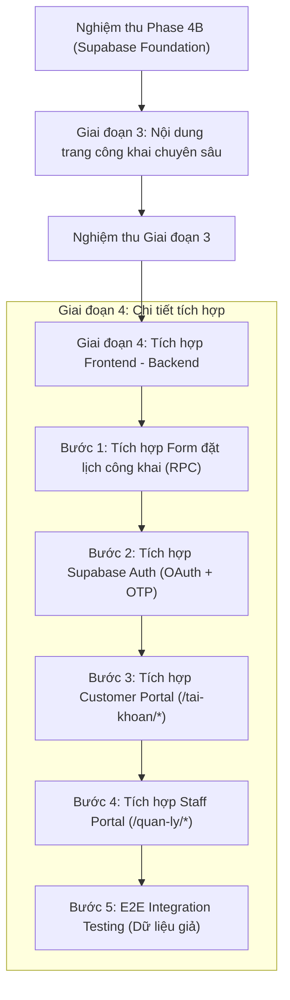

# KẾ HOẠCH TÍCH HỢP FRONTEND - BACKEND SUPABASE (PHASE TIẾP THEO)
## NEXT PHASE FRONTEND INTEGRATION PLAN (ARCHITECTURE BASELINE V1)

**Dự án:** Hệ thống Quản trị & Đặt lịch Bệnh viện Thú y Lê Sơn  
**Repository:** `lqt140304-rgb/webchinhthuc`  
**Căn cứ kiến trúc:** Architecture Baseline V1 (Quyết định ngày 26/10/2026 tại `AGENTS.md`)  
**Tác giả:** Antigravity (Designer / Developer)  
**Trình duyệt:** CEO Điều phối (ChatGPT) & Chủ dự án  

---

### I. PHÂN ĐỊNH 3 KHU VỰC GIAO DIỆN & RANH GIỚI BẢO MẬT

Theo Architecture Baseline V1, toàn bộ hệ thống giao diện được tổ chức trong cùng một kho mã nguồn duy nhất nhưng phân tách tuyệt đối thành 3 khu vực với layout và quyền truy cập độc lập:

```
+-----------------------------------------------------------------------------------------+
|                                REPOSITORY WEB CHÍNH THỨC                                |
+-----------------------------------------------------------------------------------------+
|  1. PUBLIC WEBSITE         |  2. CUSTOMER PORTAL          |  3. STAFF & MANAGEMENT      |
|  Route: /*                 |  Route: /tai-khoan/*         |  Route: /quan-ly/*          |
|  Layout: RootLayout        |  Layout: CustomerLayout      |  Layout: StaffLayout        |
|  Nhận diện: Editorial Luxury|  Đặc thù: Mobile-First       |  Đặc thù: High-Density UI   |
|  Truy cập: Khách vãng lai  |  Truy cập: Khách hàng xác thực|  Truy cập: Bác sĩ / Quản lý |
|  Dữ liệu: View công khai   |  Dữ liệu: Hồ sơ/Thú cưng RLS |  Dữ liệu: Ca trực & Lâm sàng|
+-----------------------------------------------------------------------------------------+
```

#### 1. Public Website (`RootLayout`)
- **Phạm vi:** Trang chủ, Về chúng tôi, Dịch vụ chuyên sâu, Kiến thức & Tin tức, Liên hệ.
- **Bảo toàn giao diện:** Giữ nguyên 100% nhận diện **Vibrant Editorial Luxury** và đầy đủ 6 section trang chủ.
- **Ranh giới CSDL:** Chỉ truy vấn các view công khai qua PostgREST (`public.customer_available_services_view`). Tuyệt đối không phơi bày bảng nội bộ schema `app`.
- **Trạng thái hiện tại:** Frontend tĩnh hoạt động ổn định trên Vite dev server (`http://127.0.0.1:5173/`).

#### 2. Form Đặt lịch Công khai (Interactive Public Booking Widget)
- **Vị trí:** Tích hợp trực tiếp tại Section 6 của Trang chủ và trang `/dat-lich`.
- **Trạng thái hiện tại:** Đang dùng bộ xác thực giao diện React Hook Form + Zod với dữ liệu mock.
- **Phương án tích hợp:** Kết nối trực tiếp vào RPC công khai `public.rpc_guest_create_booking`:
  - Client sinh `idempotency_key` (UUID v4) chống double-click.
  - Gateway kiểm soát Rate Limiting (tối đa 3 yêu cầu pending từ 1 SĐT).
  - Tự động ghi nhận vào bảng `app.guest_booking_requests` trạng thái `pending`.

#### 3. Customer Portal (`/tai-khoan/*` — `CustomerLayout`)
- **Mục tiêu:** Cung cấp trải nghiệm theo dõi thú cưng, lịch sử dịch vụ, và bản tin sức khỏe lưu viện thân thiện, tối ưu cho thiết bị di động (mobile-first).
- **Nguyên tắc bảo vệ dữ liệu y khoa tối thượng (Medical Privacy Invariant):**
  - **Không hiển thị:** Đơn thuốc chi tiết, tên biệt dược, liều lượng chỉ định, phác đồ điều trị nội bộ, hoặc biên bản hội chẩn lâm sàng.
  - **Thực thi tại Backend/API:** Toàn bộ dữ liệu được lọc qua view an toàn `customer_invoice_items_view` (`is_clinical_hidden = FALSE`) và `customer_bulletins_view` (`status = 'published'`). Tuyệt đối không tải dữ liệu nội bộ về máy khách rồi dùng CSS để ẩn.

#### 4. Staff & Management Portal (`/quan-ly/*` — `StaffLayout`)
- **Lưu ý định tuyến:** Đường dẫn chuẩn là `/quan-ly/*` (thay thế hoàn toàn `/nhan-vien/*`).
- **Đặc thù giao diện:** Giao diện mật độ dữ liệu cao (high-density), tối ưu tốc độ bàn phím, phân quyền theo vai trò (Bác sĩ, Tiếp tân, Điều dưỡng, Spa, Quản trị viên).
- **Ràng buộc an ninh bắt buộc:**
  - **Kiểm soát ca trực (Shift Roster):** Bác sĩ/Nhân viên chỉ được thực thi y lệnh khi đang trong ca trực hợp lệ (`check_active_shift`).
  - **Xác thực đa yếu tố AAL2:** Quản trị viên khi duyệt đợt nhập Excel (Two-man rule), xóa bệnh án, hoặc duyệt thiết bị BYOD bắt buộc phải có JWT claim `aal = 'aal2'`.

---

### II. KIẾN TRÚC HIỆU NĂNG & DESIGN SYSTEM

1. **Cô lập Bundle (Code Splitting):**
   - Áp dụng `React.lazy()` và dynamic imports cho toàn bộ module `/tai-khoan/*` và `/quan-ly/*`.
   - Người dùng truy cập trang công khai (`/`) sẽ không phải tải bất kỳ byte mã nguồn nào của hai hệ thống portal nội bộ.
2. **Hệ thống Design Tokens dùng chung (`src/styles/tokens.css`):**
   - Giữ nguyên token chuẩn làm nguồn sự thật (Single Source of Truth).
   - Bổ sung **Semantic Status Tokens** cho các trạng thái y tế và vận hành (`--status-inpatient`, `--status-quarantined`, `--status-emergency`, `--status-discharged`).
   - Public Website giữ vững tính sang trọng biên tập; Dashboard portal thừa hưởng các token ngữ nghĩa mà không làm lệch nhận diện thương hiệu.

---

### III. LỘ TRÌNH TRIỂN KHAI TỪNG BƯỚC (PHASED INTEGRATION ROADMAP)

Theo lộ trình đã được Chủ dự án và CEO phê duyệt tại `AGENTS.md`:



#### Bước 1: Tích hợp Form đặt lịch công khai (Public Booking)
- Thay thế hàm mock trong `src/components/BookingForm/` bằng cuộc gọi tới Supabase Client PostgREST RPC `rpc_guest_create_booking`.
- Kiểm thử trạng thái mạng chậm, xử lý lỗi 429 Too Many Requests, hiển thị thông báo thành công cho khách hàng vãng lai.

#### Bước 2: Tích hợp Supabase Auth (Client Authentication Provider)
- Tạo `src/lib/supabaseClient.ts` cấu hình kết nối tới Supabase Sandbox local (`http://127.0.0.1:54321`).
- Xây dựng Provider `AuthProvider.tsx` quản lý phiên đăng nhập:
  - Đăng ký / Đăng nhập Google OAuth (Mock / Local config).
  - Xác thực số điện thoại qua OTP (hỗ trợ kiểm thử lazy profile D-19).
  - Tự động lắng nghe sự kiện `onAuthStateChange` để cập nhật trạng thái session.

#### Bước 3: Tích hợp Customer Portal (`/tai-khoan/*`)
- Hiện thực khung layout `CustomerLayout.tsx` với định hướng mobile-first.
- Kết nối các view an toàn:
  - Trang danh sách thú cưng: gọi `public.customer_pets_view`.
  - Trang chi tiết thú cưng & bản tin: gọi `public.customer_bulletins_view` và lấy Signed URL 15 phút.
  - Trang hóa đơn: gọi `public.customer_invoice_items_view` (bảo đảm dòng thuốc lâm sàng bị ẩn hoàn toàn).

#### Bước 4: Tích hợp Staff & Management Portal (`/quan-ly/*`)
- Hiện thực khung layout `StaffLayout.tsx` với bảng điều hướng bên (Sidebar) phân quyền theo vai trò.
- Kết nối các màn hình vận hành:
  - Bàn tiếp tân: Quản lý lịch hẹn, tìm kiếm SĐT khách hàng đối soát mờ (P1-E).
  - Bác sĩ điều trị: Hồ sơ bệnh án, kê đơn theo ca trực (SEC-05), cảnh báo sinh hiệu (SEC-32).
  - Quản lý kho: Kiểm kê lô hàng, cách ly lô hết hạn (D-15), duyệt xuất kho.
  - Trung tâm nhập liệu: Màn hình Import Excel Staging, quy trình Two-man approval (D-07), nút Rollback đợt nhập an toàn.

#### Bước 5: Kiểm thử tích hợp đầu-cuối (E2E Integration Testing)
- Sử dụng Playwright / Vitest chạy kịch bản kiểm thử tích hợp trên toàn bộ luồng nghiệp vụ.
- Sử dụng 100% dữ liệu thử nghiệm nhân tạo (Synthetic Test Data).
- Chi phí hạ tầng tiếp tục bảo đảm $0.

---

### IV. BẢNG MA TRẬN TRẠNG THÁI HIỆN TẠI (MOCK VS REAL BACKEND)

```
+-----------------------------------------------------------------------------------------+
| PHÂN HỆ GIAO DIỆN           | HIỆN TRẠNG TRÊN FRONTEND       | TRẠNG THÁI BACKEND SUPABASE|
+-----------------------------+--------------------------------+----------------------------+
| 1. Trang chủ (6 Section)    | Đã hoàn thành (Editorial Lux)  | Không cần backend động     |
| 2. Trang dịch vụ công khai  | Đang dùng mock tĩnh            | View dịch vụ sẵn sàng      |
| 3. Form Đặt lịch vãng lai   | React Hook Form + Mock submit  | RPC rpc_guest_create_ready |
| 4. Customer Portal          | Chưa dựng UI (Chờ Giai đoạn 4) | Views RLS & RPC sẵn sàng   |
| 5. Staff Portal (/quan-ly/*)| Chưa dựng UI (Chờ Giai đoạn 4) | 40 bảng & 28 RPC sẵn sàng  |
| 6. Import Center (Excel)    | Chưa dựng UI (Chờ Giai đoạn 4) | Generic Staging & Rollback |
+-----------------------------------------------------------------------------------------+
```

---

### V. KẾT LUẬN

Hệ thống backend CSDL Supabase được phát triển trong Phase 4B đã sẵn sàng 100% các cổng giao tiếp API (Views, Triggers, RPC Wrappers) để đón nhận việc tích hợp giao diện ở Giai đoạn 4.

Antigravity đề xuất giữ nguyên hiện trạng code frontend hiện tại, không tự ý can thiệp vào giao diện portal trước khi hoàn thành **Giai đoạn 3 (Nội dung các trang chuyên sâu công khai)** và trước khi có sự phê chuẩn chính thức của Chủ dự án.
