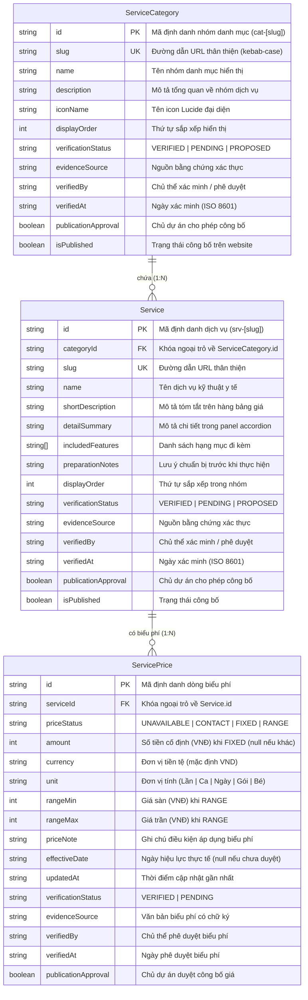

# MÔ HÌNH DỮ LIỆU DỊCH VỤ & BẢNG GIÁ GIAI ĐOẠN 3B — PHIÊN BẢN V1.1 (PHASE 3B-00 DATA SCHEMA)
## Bệnh viện Thú y Lê Sơn 2026 — Mô Hình Dữ Liệu Logic (Logical Data Model)

| Hạng mục | Thông tin chi tiết |
| :--- | :--- |
| **Dự án** | Website Bệnh viện Thú y Lê Sơn 2026 (`lqt140304-rgb/webchinhthuc`) |
| **Căn cứ chỉ đạo** | **CEO DIRECTIVE 042-A (Section VIII, IX)**; `docs/phase-3b/3b-00-content-evidence-gate.md`; Báo cáo Claude QA `docs/qa/3b-00-design-doc-qa.md` |
| **Bản chất tài liệu** | **LOGICAL DATA MODEL & TYPE DEFINITION ONLY** (Chưa phải Migration SQL, Prisma schema, API hoặc Database thực thi) |
| **Giai đoạn** | **3B-00: DOCUMENTATION ONLY — KHÔNG CODE / KHÔNG DATABASE** |
| **Trạng thái tài liệu** | **CHỜ CHỦ DỰ ÁN PHÊ DUYỆT (PENDING OWNER APPROVAL)** |

---

## 1. SƠ ĐỒ QUAN HỆ THỰC THỂ (ENTITY RELATIONSHIP DIAGRAM)

Mô hình dữ liệu logic gồm 3 thực thể chuẩn hóa, tích hợp đầy đủ các trường kiểm soát bằng chứng nội dung theo quy chế `Content Evidence Gate`:



---

## 2. ĐẶC TẢ CHI TIẾT CÁC THỰC THỂ DỮ LIỆU

### 2.1. Thực thể `ServiceCategory` (Nhóm danh mục dịch vụ)

| Trường dữ liệu | Kiểu dữ liệu | Bắt buộc | Ràng buộc / Định dạng | Ý nghĩa & Quy tắc |
|---|---|---|---|---|
| `id` | `string` | Có | Định dạng chuỗi `cat-[slug]` | Khóa chính duy nhất. |
| `slug` | `string` | Có | `^[a-z0-9-]+$` | URL slug (ví dụ: `kham-dieu-tri`, `can-lam-sang`, `phau-thuat`, `noi-tru`, `spa-grooming`). |
| `name` | `string` | Có | Tối đa 100 ký tự | Tên nhóm danh mục tiếng Việt. |
| `description` | `string` | Có | Tối đa 300 ký tự | Tóm tắt định hướng chuyên môn của nhóm dịch vụ. |
| `iconName` | `string` | Có | Tên icon `lucide-react` | Ví dụ: `Stethoscope`, `Activity`, `Scissors`, `Home`, `Sparkles`. |
| `displayOrder` | `number` | Có | Số nguyên không âm $\ge 0$ | Thứ tự ưu tiên hiển thị trên Toolbar và Section. |
| `verificationStatus` | `enum` | Có | `'VERIFIED' \| 'PENDING' \| 'PROPOSED'` | Trạng thái xác minh của nhóm danh mục. |
| `evidenceSource` | `string \| null` | Không | Chuỗi mô tả nguồn | Căn cứ pháp lý / chỉ đạo CEO. |
| `verifiedBy` | `string \| null` | Không | Tên người duyệt cụ thể | Bắt buộc nếu status = `VERIFIED`. |
| `verifiedAt` | `string \| null` | Không | ISO 8601 Date (`YYYY-MM-DD`) | Ngày phê duyệt chính thức. |
| `publicationApproval` | `boolean` | Có | `true \| false` | Quyết định cho phép công bố từ chủ dự án. |
| `isPublished` | `boolean` | Có | `true \| false` | Cờ hiển thị công khai trên website. |

### 2.2. Thực thể `Service` (Dịch vụ y tế chi tiết)

| Trường dữ liệu | Kiểu dữ liệu | Bắt buộc | Ràng buộc / Định dạng | Ý nghĩa & Quy tắc |
|---|---|---|---|---|
| `id` | `string` | Có | Định dạng chuỗi `srv-[slug]` | Khóa chính duy nhất. |
| `categoryId` | `string` | Có | Khóa ngoại tới `ServiceCategory.id` | Nhóm danh mục trực thuộc. |
| `slug` | `string` | Có | `^[a-z0-9-]+$` | Mã slug định danh dịch vụ. |
| `name` | `string` | Có | Tối đa 150 ký tự | Tên chuẩn kỹ thuật của dịch vụ. |
| `shortDescription` | `string` | Có | Tối đa 250 ký tự | Đoạn mô tả cô đọng xuất hiện trên hàng bảng giá. |
| `detailSummary` | `string` | Không | Tối đa 600 ký tự | Mô tả chuyên sâu xuất hiện trong panel accordion khi bung mở. |
| `includedFeatures` | `string[]` | Không | Mảng chuỗi ký tự | Danh sách các bước/vật tư đi kèm trong dịch vụ. |
| `preparationNotes` | `string` | Không | Tối đa 300 ký tự | Hướng dẫn chủ nuôi chuẩn bị trước khi làm dịch vụ (ví dụ: nhịn ăn). |
| `displayOrder` | `number` | Có | Số nguyên $\ge 0$ | Thứ tự xuất hiện trong bảng danh mục. |
| `verificationStatus` | `enum` | Có | `'VERIFIED' \| 'PENDING' \| 'PROPOSED'` | Trạng thái xác minh chuyên môn. |
| `evidenceSource` | `string \| null` | Không | Chuỗi mô tả nguồn | Căn cứ phê duyệt danh mục. |
| `verifiedBy` | `string \| null` | Không | Tên người duyệt | Bắt buộc nếu status = `VERIFIED`. |
| `verifiedAt` | `string \| null` | Không | ISO 8601 Date | Ngày phê duyệt chuyên môn. |
| `publicationApproval` | `boolean` | Có | `true \| false` | Quyết định công bố từ chủ dự án. |
| `isPublished` | `boolean` | Có | `true \| false` | Cho phép xuất hiện trên bảng giá. |

### 2.3. Thực thể `ServicePrice` (Biểu phí dịch vụ)

| Trường dữ liệu | Kiểu dữ liệu | Bắt buộc | Ràng buộc / Định dạng | Ý nghĩa & Quy tắc |
|---|---|---|---|---|
| `id` | `string` | Có | `prc-[serviceId]-[unit]` | Khóa chính duy nhất. |
| `serviceId` | `string` | Có | Khóa ngoại tới `Service.id` | Dịch vụ được định giá. |
| `priceStatus` | `enum` | Có | `'UNAVAILABLE' \| 'CONTACT' \| 'FIXED' \| 'RANGE'` | **4 trạng thái giá cốt lõi**. |
| `amount` | `number \| null` | Tùy status | Số nguyên dương $> 0$ (VNĐ) | Số tiền cố định khi `FIXED`. Bắt buộc `null` nếu status khác. |
| `currency` | `string` | Có | Mặc định `'VND'` | Chuẩn ISO-4217, hiển thị `VNĐ`. |
| `unit` | `string` | Có | Chuỗi tiếng Việt | Ví dụ: `Lần`, `Ca`, `Ngày`, `Gói`, `Bé`. |
| `rangeMin` | `number \| null` | Tùy status | Số nguyên dương $> 0$ (VNĐ) | Giá sàn khi `RANGE`. Phải nhỏ hơn `rangeMax`. |
| `rangeMax` | `number \| null` | Tùy status | Số nguyên dương $> 0$ (VNĐ) | Giá trần khi `RANGE`. Phải lớn hơn `rangeMin`. |
| `priceNote` | `string` | Không | Tối đa 250 ký tự | Điều kiện biến động giá (ví dụ: tùy cân nặng, tiền thuốc). |
| `effectiveDate` | `string \| null` | Có | ISO 8601 Date hoặc `null` | Ngày bắt đầu áp dụng thực tế. Bắt buộc `null` nếu chưa duyệt. |
| `updatedAt` | `string` | Có | ISO 8601 Timestamp | Thời điểm rà soát biểu phí gần nhất. |
| `verificationStatus` | `enum` | Có | `'VERIFIED' \| 'PENDING'` | Phê duyệt từ chủ dự án trước khi công bố giá. |
| `evidenceSource` | `string \| null` | Không | Tên văn bản biểu phí | Bắt buộc nếu status = `VERIFIED`. |
| `verifiedBy` | `string \| null` | Không | Tên chủ dự án ký duyệt | Bắt buộc nếu status = `VERIFIED`. |
| `verifiedAt` | `string \| null` | Không | ISO 8601 Date | Ngày ký quyết định ban hành giá. |
| `publicationApproval` | `boolean` | Có | `true \| false` | Quyết định công bố giá. |

---

## 3. QUY TẮC RÀNG BUỘC GIỮA XÁC MINH VÀ CÔNG BỐ (VERIFICATION VS PUBLICATION RULES)

Để ngăn ngừa lỗi hiển thị thông tin chưa kiểm chứng ra công chúng, hệ thống áp dụng các quy tắc logic chặt chẽ:

1. **Quy tắc `isPublished` phụ thuộc `verificationStatus`:**
   - Nếu `verificationStatus === 'VERIFIED'` VÀ `publicationApproval === true`: Dữ liệu được công bố chính thức, không cần nhãn bảo lưu.
   - Nếu `verificationStatus === 'PENDING'` hoặc `'PROPOSED'`:
     - Trên môi trường Preview kiểm thử giao diện: Có thể đặt `isPublished = true` **VỚI ĐIỀU KIỆN BẮT BUỘC** là giao diện phải tự động gắn nhãn `[Đề xuất]` hoặc badge `UNAVAILABLE` / `CONTACT`.
     - Trên môi trường Production chính thức: Bắt buộc `isPublished = false` (ẩn hoàn toàn) cho đến khi chuyển thành `VERIFIED`.
2. **Quy tắc tính hợp lệ của số tiền (Price Validation Constraints):**
   - Khi `priceStatus === 'UNAVAILABLE'`: Bắt buộc `amount === null`, `rangeMin === null`, `rangeMax === null`. Tuyệt đối không lưu giá trị `0`.
   - Khi `priceStatus === 'CONTACT'`: Bắt buộc `amount === null`, `rangeMin === null`, `rangeMax === null` và bắt buộc có `priceNote` giải thích lý do cần khám trước.
   - Khi `priceStatus === 'FIXED'`: Bắt buộc `amount > 0`, `rangeMin === null`, `rangeMax === null` và `verificationStatus === 'VERIFIED'`.
   - Khi `priceStatus === 'RANGE'`: Bắt buộc `rangeMin > 0`, `rangeMax > rangeMin`, `amount === null` và `verificationStatus === 'VERIFIED'`.

---

## 4. XỬ LÝ CÁC TRƯỜNG HỢP BIÊN & MỞ RỘNG TƯƠNG LAI (EDGE CASES & SCALABILITY)

### 4.1. Xử lý tên dịch vụ dài (Long Service Names)
- Khi tên dịch vụ vượt quá 50 ký tự (ví dụ: "Xét nghiệm sinh hóa máu kiểm tra chức năng gan thận chuyên sâu 14 chỉ số"):
  - Trên Desktop: Cho phép ngắt dòng tự nhiên (`break-words`), không cắt cụt bằng dấu ba chấm (`ellipsis`) để đảm bảo tính rõ ràng y khoa.
  - Trên Mobile: Hàng accordion co giãn chiều cao linh hoạt, giữ vùng đệm tối thiểu `min-h-[56px]`.

### 4.2. Xử lý danh mục trống (Empty Categories)
- Nếu một nhóm danh mục chưa có bất kỳ dịch vụ nào được công bố (`isPublished = true` có 0 phần tử):
  - Tab danh mục đó trên thanh Toolbar tự động ẩn đi để tránh hiển thị tab rỗng cho người dùng.
  - Nếu người dùng truy cập trực tiếp qua URL deep-link (ví dụ: `?cat=trong`), bảng giá hiển thị thông báo trung tính: *"Danh mục này đang được cập nhật dịch vụ niêm yết"* kèm nút quay lại tab Tất cả.

### 4.3. Mô hình phân tầng giá theo cân nặng (Tiered Weight Pricing Model)
Để chuẩn bị cho dịch vụ Spa Grooming và Nội trú lưu chuồng trong tương lai mà không cần đập đi xây lại schema, mở rộng cấu trúc `weightTiers` dự phòng trong `ServicePrice`:

```typescript
export interface WeightTierPrice {
  minKg: number
  maxKg?: number // Không có nếu là nấc trần (ví dụ: > 20kg)
  priceStatus: 'UNAVAILABLE' | 'CONTACT' | 'FIXED' | 'RANGE'
  amount?: number | null
  rangeMin?: number | null
  rangeMax?: number | null
  tierLabel: string // Ví dụ: "Dưới 5kg", "5 – 10kg", "10 – 20kg", "Trên 20kg"
}
```

---

## 5. BỘ DỮ LIỆU THỬ NGHIỆM TRUNG TÍNH (TEST-ONLY NEUTRAL FIXTURES)

> [!CAUTION] CẢNH BÁO QUAN TRỌNG: TEST-ONLY FIXTURES
> Dữ liệu dưới đây là mã nguồn thử nghiệm nội bộ, được trung tính hóa hoàn toàn:
> - **0 người thật** (đã gỡ bỏ toàn bộ tên BS. Lê Thái Sơn khỏi fixture kỹ thuật).
> - **0 thiết bị tự tạo** (không bịa đặt máy gây mê hay thiết bị vô trùng).
> - **0 số tiền giả** (thay thế mọi số tiền cụ thể bằng placeholder `[Số tiền niêm yết]`).
> - Cờ `testOnly: true` và `isPublished: false`.

```typescript
// tests/fixtures/neutralPricingFixtures.ts (TEST ONLY — KHÔNG IMPORT VÀO PRODUCTION)
export const TEST_ONLY_NEUTRAL_FIXTURES = [
  {
    id: 'srv-sample-exam-01',
    categoryId: 'cat-kham-dieu-tri',
    slug: 'kham-lam-sang-mau',
    name: 'Dịch vụ khám lâm sàng thử nghiệm mẫu',
    shortDescription: 'Mô tả ngắn gọn quy trình thăm khám phục vụ kiểm thử giao diện.',
    detailSummary: 'Nội dung chi tiết các bước kiểm tra lâm sàng cơ bản mẫu.',
    includedFeatures: ['Kiểm tra sinh hiệu mẫu', 'Tư vấn chăm sóc mẫu'],
    preparationNotes: 'Lưu ý chuẩn bị mẫu cho người nuôi.',
    displayOrder: 1,
    verificationStatus: 'PENDING',
    evidenceSource: null,
    verifiedBy: null,
    verifiedAt: null,
    publicationApproval: false,
    isPublished: false,
    testOnly: true,
    price: {
      id: 'prc-sample-exam-01',
      serviceId: 'srv-sample-exam-01',
      priceStatus: 'UNAVAILABLE', // Đúng quy tắc: Dữ liệu chưa xác minh bắt buộc UNAVAILABLE
      amount: null,
      currency: 'VND',
      unit: 'Lần',
      rangeMin: null,
      rangeMax: null,
      priceNote: 'Biểu phí đang được đối chiếu niêm yết chính thức.',
      effectiveDate: null, // Đúng quy tắc: Không dùng ngày hiệu lực giả
      updatedAt: '2026-10-28T00:00:00Z',
      verificationStatus: 'PENDING',
      evidenceSource: null,
      verifiedBy: null,
      verifiedAt: null,
      publicationApproval: false,
    },
  },
  {
    id: 'srv-sample-surgery-02',
    categoryId: 'cat-phau-thuat',
    slug: 'phau-thuat-tieu-phau-mau',
    name: 'Dịch vụ tiểu phẫu thử nghiệm mẫu',
    shortDescription: 'Mô tả quy trình tiểu phẫu mẫu phục vụ kiểm thử trạng thái CONTACT.',
    detailSummary: 'Quy trình theo dõi và trao đổi phác đồ chi tiết trước can thiệp mẫu.',
    includedFeatures: ['Quy trình sát khuẩn mẫu', 'Theo dõi hồi tỉnh mẫu'],
    preparationNotes: 'Trao đổi trước với bác sĩ về thời gian nhịn ăn của bé.',
    displayOrder: 2,
    verificationStatus: 'PENDING',
    evidenceSource: null,
    verifiedBy: null,
    verifiedAt: null,
    publicationApproval: false,
    isPublished: false,
    testOnly: true,
    price: {
      id: 'prc-sample-surgery-02',
      serviceId: 'srv-sample-surgery-02',
      priceStatus: 'CONTACT', // Trạng thái báo giá sau khám lâm sàng
      amount: null,
      currency: 'VND',
      unit: 'Ca',
      rangeMin: null,
      rangeMax: null,
      priceNote: 'Chi phí phụ thuộc mức độ tổn thương thực tế sau thăm khám.',
      effectiveDate: null,
      updatedAt: '2026-10-28T00:00:00Z',
      verificationStatus: 'PENDING',
      evidenceSource: null,
      verifiedBy: null,
      verifiedAt: null,
      publicationApproval: false,
    },
  },
]
```

---

**KẾT THÚC MÔ HÌNH DỮ LIỆU GIAI ĐOẠN 3B (DATA SCHEMA V1.1)**
