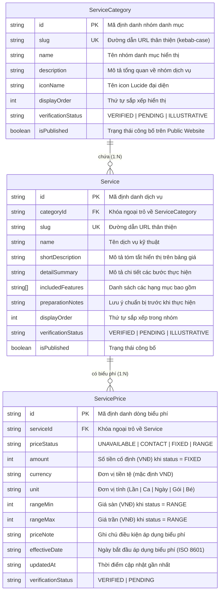

# MÔ HÌNH DỮ LIỆU DỊCH VỤ & BẢNG GIÁ GIAI ĐOẠN 3B — PHIÊN BẢN V1.0 (PHASE 3B-00 DATA SCHEMA)
## Bệnh viện Thú y Lê Sơn 2026 — Mô Hình Dữ Liệu Logic (Logical Data Model)

| Hạng mục | Thông tin chi tiết |
| :--- | :--- |
| **Dự án** | Website Bệnh viện Thú y Lê Sơn 2026 (`lqt140304-rgb/webchinhthuc`) |
| **Căn cứ chỉ đạo** | **CEO DIRECTIVE 038-A (Section VII)**; `AGENTS.md` (Architecture Baseline V1) |
| **Bản chất tài liệu** | **LOGICAL DATA MODEL & TYPE DEFINITION ONLY** (Chưa phải Migration SQL, Prisma schema, API hoặc Database thực thi) |
| **Giai đoạn** | **3B-00: DOCUMENTATION ONLY — KHÔNG CODE / KHÔNG DATABASE** |
| **Phạm vi** | Chuẩn hóa cấu trúc thực thể cho danh mục dịch vụ (`/dich-vu`) và bảng giá niêm yết (`/bang-gia`) |

---

## 1. SƠ ĐỒ QUAN HỆ THỰC THỂ (ENTITY RELATIONSHIP DIAGRAM)

Mô hình dữ liệu dịch vụ được thiết kế theo cấu trúc phân cấp chuẩn hóa gồm 3 thực thể logic cốt lõi:
1. **`ServiceCategory`** (Nhóm danh mục dịch vụ): Quản lý phân loại y khoa cấp 1 (Khám, Xét nghiệm, Phẫu thuật, Nội trú, Spa).
2. **`Service`** (Dịch vụ y tế): Quản lý thông tin chi tiết từng dịch vụ, mô tả lâm sàng, điều kiện chuẩn bị.
3. **`ServicePrice`** (Biểu phí dịch vụ): Tách biệt độc lập khỏi dịch vụ để quản lý đa trạng thái giá, khoảng giá, đơn vị tính và lịch sử hiệu lực.



---

## 2. ĐẶC TẢ CHI TIẾT CÁC THỰC THỂ DỮ LIỆU

### 2.1. Thực thể `ServiceCategory` (Nhóm danh mục dịch vụ)
Quản lý các nhóm dịch vụ chính, dùng để sinh ra thanh Jump Bar trên `/dich-vu` và hệ thống Tabs phân loại trên `/bang-gia`.

| Trường dữ liệu | Kiểu dữ liệu | Bắt buộc | Ràng buộc / Định dạng | Ý nghĩa & Quy tắc |
|---|---|---|---|---|
| `id` | `string` | Có | Định dạng chuỗi `cat-[slug]` | Khóa chính duy nhất. |
| `slug` | `string` | Có | `^[a-z0-9-]+$` | URL slug (ví dụ: `kham-dieu-tri`, `xet-nghiem`, `noi-tru`, `spa`). |
| `name` | `string` | Có | Tối đa 100 ký tự | Tên nhóm danh mục tiếng Việt (ví dụ: `Khám & Điều trị lâm sàng`). |
| `description` | `string` | Có | Tối đa 300 ký tự | Tóm tắt năng lực y khoa và mục tiêu của nhóm dịch vụ. |
| `iconName` | `string` | Có | Tên component `lucide-react` | Ví dụ: `Stethoscope`, `Activity`, `Home`, `Sparkles`, `ShieldAlert`. |
| `displayOrder` | `number` | Có | Số nguyên không âm $\ge 0$ | Thứ tự ưu tiên hiển thị trên giao diện người dùng. |
| `verificationStatus` | `enum` | Có | `'VERIFIED' \| 'PENDING'` | Trạng thái xác minh của nhóm danh mục. |
| `isPublished` | `boolean` | Có | `true \| false` | Cờ kích hoạt hiển thị công khai trên website. |

### 2.2. Thực thể `Service` (Dịch vụ y tế chi tiết)
Quản lý các dịch vụ cụ thể thuộc từng nhóm danh mục.

| Trường dữ liệu | Kiểu dữ liệu | Bắt buộc | Ràng buộc / Định dạng | Ý nghĩa & Quy tắc |
|---|---|---|---|---|
| `id` | `string` | Có | Định dạng chuỗi `srv-[slug]` | Khóa chính duy nhất. |
| `categoryId` | `string` | Có | Khóa ngoại tới `ServiceCategory.id` | Nhóm danh mục trực thuộc. |
| `slug` | `string` | Có | `^[a-z0-9-]+$` | Mã slug định danh dịch vụ (ví dụ: `kham-tong-quat`, `triet-san-meo`). |
| `name` | `string` | Có | Tối đa 150 ký tự | Tên chuẩn y tế của dịch vụ (ví dụ: `Khám lâm sàng tổng quát`). |
| `shortDescription` | `string` | Có | Tối đa 250 ký tự | Đoạn mô tả cô đọng xuất hiện trên hàng bảng giá. |
| `detailSummary` | `string` | Không | Tối đa 600 ký tự | Mô tả chuyên sâu xuất hiện trong panel accordion khi bung mở. |
| `includedFeatures` | `string[]` | Không | Mảng chuỗi ký tự | Danh sách các bước/vật tư đi kèm trong dịch vụ. |
| `preparationNotes` | `string` | Không | Tối đa 300 ký tự | Hướng dẫn chủ nuôi chuẩn bị trước khi làm dịch vụ (ví dụ: nhịn ăn). |
| `displayOrder` | `number` | Có | Số nguyên $\ge 0$ | Thứ tự xuất hiện trong bảng danh mục. |
| `verificationStatus` | `enum` | Có | `'VERIFIED' \| 'PENDING'` | Trạng thái xác minh chuyên môn từ bác sĩ phụ trách. |
| `isPublished` | `boolean` | Có | `true \| false` | Cho phép xuất hiện trên bảng giá công khai. |

### 2.3. Thực thể `ServicePrice` (Biểu phí dịch vụ)
Quản lý giá, trạng thái niêm yết và chính sách chi phí.

| Trường dữ liệu | Kiểu dữ liệu | Bắt buộc | Ràng buộc / Định dạng | Ý nghĩa & Quy tắc |
|---|---|---|---|---|
| `id` | `string` | Có | Định dạng chuỗi `prc-[serviceId]-[unit]` | Khóa chính duy nhất. |
| `serviceId` | `string` | Có | Khóa ngoại tới `Service.id` | Dịch vụ được định giá. |
| `priceStatus` | `enum` | Có | `'UNAVAILABLE' \| 'CONTACT' \| 'FIXED' \| 'RANGE'` | **4 trạng thái giá cốt lõi** (chi tiết tại Mục 3). |
| `amount` | `number \| null` | Tùy status | Số nguyên dương $> 0$ (VNĐ) | Số tiền chính xác khi `priceStatus = 'FIXED'`. Bắt buộc `null` nếu status khác. |
| `currency` | `string` | Có | Mặc định `'VND'` | Chuẩn ISO-4217, hiển thị là `VNĐ` trên giao diện. |
| `unit` | `string` | Có | Chuỗi tiếng Việt | Ví dụ: `Lần`, `Ca`, `Ngày`, `Gói`, `Bé`. |
| `rangeMin` | `number \| null` | Tùy status | Số nguyên dương $> 0$ (VNĐ) | Giá sàn khi `priceStatus = 'RANGE'`. Phải nhỏ hơn `rangeMax`. |
| `rangeMax` | `number \| null` | Tùy status | Số nguyên dương $> 0$ (VNĐ) | Giá trần khi `priceStatus = 'RANGE'`. Phải lớn hơn `rangeMin`. |
| `priceNote` | `string` | Không | Tối đa 250 ký tự | Điều kiện biến động giá (ví dụ: tùy cân nặng, tiền thuốc phát sinh). |
| `effectiveDate` | `string` | Có | Chuỗi ISO 8601 (YYYY-MM-DD) | Ngày có hiệu lực của biểu phí niêm yết. |
| `updatedAt` | `string` | Có | Chuỗi ISO 8601 Timestamp | Thời điểm rà soát biểu phí gần nhất. |
| `verificationStatus` | `enum` | Có | `'VERIFIED' \| 'PENDING'` | Phê duyệt từ chủ dự án trước khi công bố giá. |

---

## 3. ĐẶC TẢ 4 TRẠNG THÁI GIÁ & QUY TẮC HIỂN THỊ (PRICE STATUS LOGIC)

Thiết kế loại trừ hoàn toàn rủi ro hiểu nhầm giá hoặc hiển thị số tiền tùy tiện:

```text
               ┌────────────────────────────────────────────────────────┐
               │           Trạng thái biểu phí (Price Status)           │
               └───────────────────────────┬────────────────────────────┘
                                           │
         ┌───────────────────┬─────────────┴───────┬───────────────────┐
         ▼                   ▼                     ▼                   ▼
    UNAVAILABLE           CONTACT                FIXED               RANGE
┌───────────────────┐┌───────────────────┐┌───────────────────┐┌───────────────────┐
│ Chưa có dữ liệu   ││ Cần tư vấn/khám   ││ Giá niêm yết cố   ││ Dao động theo cân │
│ giá được xác minh ││ trước khi báo giá ││ định chính xác    ││ nặng, mức độ ca  │
├───────────────────┤├───────────────────┤├───────────────────┤├───────────────────┤
│ Badge Lavender    ││ Badge Hổ phách    ││ Số tiền in đậm    ││ Khoảng tiền rõ    │
│ "Đang cập nhật    ││ "Báo giá sau      ││ "150.000 VNĐ"     ││ "300.000 –        │
│ biểu phí niêm yết"││ khám lâm sàng"    ││                   ││  600.000 VNĐ"     │
└───────────────────┘└───────────────────┘└───────────────────┘└───────────────────┘
```

### 3.1. Trạng thái `UNAVAILABLE` (Chưa có dữ liệu giá được xác minh)
- **Ý nghĩa nghiệp vụ:** Dịch vụ có cung cấp tại bệnh viện nhưng biểu phí đang trong quá trình chuẩn hóa hoặc chờ chủ dự án ký duyệt.
- **Quy tắc ràng buộc:**
  - `amount = null`, `rangeMin = null`, `rangeMax = null`.
  - **Tuyệt đối không gán `amount = 0`**.
- **Hiển thị giao diện:**
  - Badge màu tím nhạt (`bg-purple-100 text-[var(--color-plum-primary)] border border-purple-200/60`).
  - Nội dung text hiển thị: `Đang cập nhật biểu phí niêm yết`.
  - Không hiển thị bất kỳ ký tự số tiền nào.

### 3.2. Trạng thái `CONTACT` (Báo giá sau khám lâm sàng)
- **Ý nghĩa nghiệp vụ:** Các ca phẫu thuật phức tạp, chấn thương chỉnh hình hoặc điều trị nội khoa kéo dài không thể áp dụng giá cố định trước khi bác sĩ chẩn đoán trực tiếp.
- **Quy tắc ràng buộc:**
  - `amount = null`, `rangeMin = null`, `rangeMax = null`.
  - Bắt buộc có `priceNote` giải thích lý do cần khám trước.
- **Hiển thị giao diện:**
  - Badge màu hổ phách (`bg-amber-100 text-amber-900 border border-amber-300`).
  - Nội dung text hiển thị: `Báo giá sau khám lâm sàng`.

### 3.3. Trạng thái `FIXED` (Giá cố định đã xác minh)
- **Ý nghĩa nghiệp vụ:** Dịch vụ có mức phí trọn gói không phụ thuộc thể trạng (ví dụ: công khám ban đầu, sổ y bạ, triệt sản mèo đực tiêu chuẩn).
- **Quy tắc ràng buộc:**
  - `amount` bắt buộc phải là số nguyên dương $> 0$.
  - `verificationStatus` bắt buộc phải là `VERIFIED`.
- **Hiển thị giao diện:**
  - Chữ số hiển thị định dạng chuẩn Việt Nam: `150.000 VNĐ / Lần` (Be Vietnam Pro 700, màu Deep Plum `#421247`).

### 3.4. Trạng thái `RANGE` (Khoảng giá theo phân loại thể trọng)
- **Ý nghĩa nghiệp vụ:** Dịch vụ có chi phí dao động theo thể trạng hoặc cân nặng (ví dụ: gói tắm spa thú cưng theo cân nặng, ngày lưu trú nội trú theo kích thước chuồng).
- **Quy tắc ràng buộc:**
  - `rangeMin` và `rangeMax` bắt buộc là số nguyên dương $> 0$ và $rangeMin < rangeMax$.
  - `verificationStatus` bắt buộc phải là `VERIFIED`.
- **Hiển thị giao diện:**
  - Định dạng hiển thị: `300.000 – 600.000 VNĐ / Lần` (kèm ghi chú: *tùy theo cân nặng của bé*).

---

## 4. DỮ LIỆU THỬ NGHIỆM MÔ PHỎNG (TEST-ONLY MOCK DATA)

> [!WARNING] CẢNH BÁO QUAN TRỌNG: DỮ LIỆU DƯỚI ĐÂY LÀ "TEST-ONLY MOCK DATA"
> Danh sách dữ liệu mẫu này **CHỈ DÙNG CHO MỤC ĐÍCH KIỂM THỬ GIAO DIỆN NỘI BỘ VÀ TÍNH TOÀN VẸN CỦA ACCORDION/SEARCH TOOLBAR**.
> Tuyệt đối không sử dụng các con số này làm thông tin công bố chính thức ra công chúng. Mọi dịch vụ công khai trong Giai đoạn 3B phải giữ nguyên trạng thái `UNAVAILABLE` hoặc `CONTACT` cho đến khi có biểu phí chính thức được ký duyệt.

```typescript
// tests/fixtures/mockPricingData.ts (TEST ONLY — KHÔNG IMPORT VÀO PRODUCTION BUNDLE)
export const TEST_ONLY_PRICING_FIXTURES = [
  {
    id: 'srv-kham-tong-quat',
    categoryId: 'cat-kham-dieu-tri',
    slug: 'kham-tong-quat',
    name: 'Khám lâm sàng tổng quát ban đầu',
    shortDescription: 'Đo thân nhiệt, nghe tim phổi, kiểm tra niêm mạc và tư vấn dinh dưỡng y khoa.',
    detailSummary: 'Quy trình kiểm tra toàn diện 7 cơ quan trọng yếu nhằm phát hiện sớm các dấu hiệu tiềm ẩn.',
    includedFeatures: ['Kiểm tra mắt, tai, mũi họng', 'Đo sinh hiệu & cân nặng', 'Lập sổ theo dõi sức khỏe'],
    displayOrder: 1,
    verificationStatus: 'PENDING',
    isPublished: true,
    price: {
      priceStatus: 'UNAVAILABLE', // Tuân thủ Content Lock: Không để giá giả
      amount: null,
      currency: 'VND',
      unit: 'Lần',
      rangeMin: null,
      rangeMax: null,
      priceNote: 'Biểu phí đang được đối chiếu niêm yết chính thức.',
      effectiveDate: '2026-11-01',
      updatedAt: '2026-10-28T00:00:00Z',
      verificationStatus: 'PENDING',
    },
  },
  {
    id: 'srv-phau-thuat-mo-mem',
    categoryId: 'cat-kham-dieu-tri',
    slug: 'phau-thuat-mo-mem',
    name: 'Phẫu thuật ngoại khoa mô mềm & xử lý vết thương',
    shortDescription: 'Can thiệp ngoại khoa vết thương hở, u bướu hoặc thoát vị trong phòng mổ vô trùng.',
    detailSummary: 'Thực hiện bởi BS. Lê Thái Sơn với hệ thống máy gây mê bay hơi và khử khuẩn áp lực dương.',
    includedFeatures: ['Gây mê an toàn', 'Vật tư tiêu hao phòng mổ', 'Theo dõi hồi tỉnh 2 giờ'],
    displayOrder: 4,
    verificationStatus: 'PENDING',
    isPublished: true,
    price: {
      priceStatus: 'CONTACT', // Báo giá sau khám lâm sàng
      amount: null,
      currency: 'VND',
      unit: 'Ca',
      rangeMin: null,
      rangeMax: null,
      priceNote: 'Chi phí phụ thuộc mức độ tổn thương thực tế và kích thước u mô.',
      effectiveDate: '2026-11-01',
      updatedAt: '2026-10-28T00:00:00Z',
      verificationStatus: 'PENDING',
    },
  },
]
```

---

## 5. ĐỊNH HƯỚNG QUY TRÌNH QUẢN TRỊ & KHẢ NĂNG TÍCH HỢP TƯƠNG LAI (PHASE 4 COMPATIBILITY)

Mô hình dữ liệu logic này được thiết kế tương thích sẵn với lộ trình **Giai đoạn 4: Staff & Management Portal (`/quan-ly/*`)**:

1. **Giao diện cập nhật biểu phí cho Quản trị viên (`/quan-ly/dich-vu`):**
   - Bác sĩ hoặc Quản trị viên phòng khám có thể thay đổi trạng thái giá, cập nhật mức giá mới hoặc thêm dịch vụ kỹ thuật.
   - Khi chỉnh sửa, hệ thống tự động ghi lại `effectiveDate` và `updatedAt` để phục vụ đối chiếu y khoa.
2. **Quy tắc làm sạch dữ liệu trước khi trả về Public Website (API Sanitization):**
   - API công khai phục vụ `/dich-vu` và `/bang-gia` chỉ trả về các trường công cộng (`name`, `shortDescription`, `priceStatus`, `amount`, `rangeMin`, `rangeMax`, `unit`, `priceNote`).
   - Tuyệt đối loại bỏ các trường quản trị nội bộ: giá vốn vật tư, biên lợi nhuận, ghi chú bác sĩ, mã nhà cung cấp thuốc.
3. **Đồng bộ với phân hệ Đặt lịch khám (`/dat-lich`):**
   - Form đặt lịch khám có thể gọi danh sách dịch vụ đang công bố (`isPublished = true`) để hiển thị dropdown cho khách hàng lựa chọn dịch vụ cần hẹn khám.

---

**KẾT THÚC MÔ HÌNH DỮ LIỆU GIAI ĐOẠN 3B (DATA SCHEMA V1.0)**
