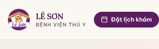
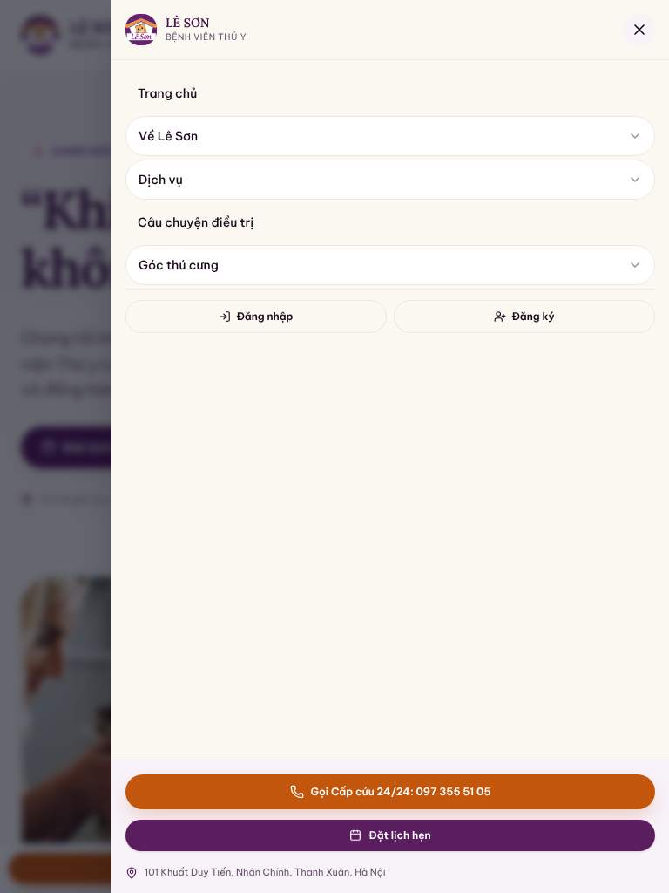
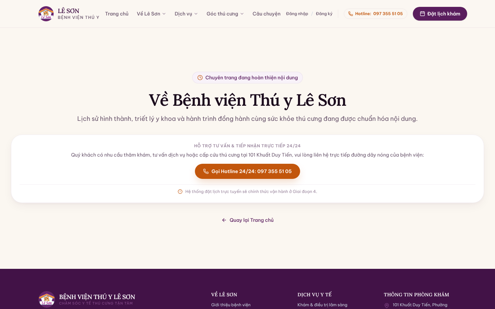

# Hồ sơ QA mốc 2A

- [Báo cáo Claude lần 3](bao-cao-kiem-tra-2A.md): bản gốc do người dùng cung cấp, giữ nguyên nội dung; SHA được review là `c2e5361defb0d151bf14c8153a341072060c2e42`.
- Ngày kiểm tra do báo cáo ghi: 25/10/2026. Ngày đưa vào repo: 26/10/2026.
- Các đường dẫn scratchpad và script trong báo cáo thuộc môi trường Claude. Repo chỉ nhận được báo cáo và ba ảnh bên dưới; chưa nhận `qa-result.json`, `qa.js`, `qa2.js` hoặc các ảnh khác. Không coi chúng là tệp có sẵn trong repo.
- Kết quả kiểm thử là do Claude báo cáo, không phải một lần kiểm thử mới của ChatGPT.

## Ảnh gốc người dùng cung cấp

### Header 320px — P1-1

### Drawer 768px — P1-2

### ComingSoon 1440px — P1-2

Đây là ảnh trước sửa. Ảnh sau sửa cần lưu riêng, kèm SHA và viewport thực tế. Không ghi đè bằng chứng gốc.
